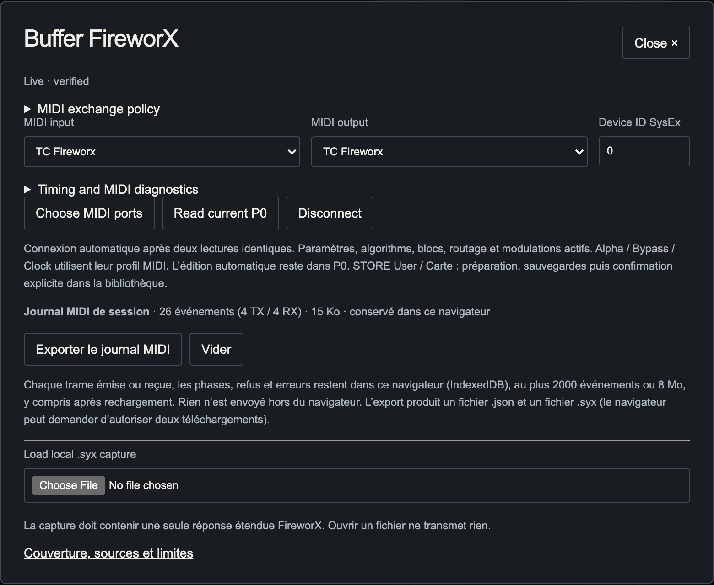
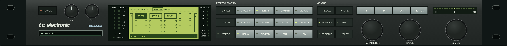
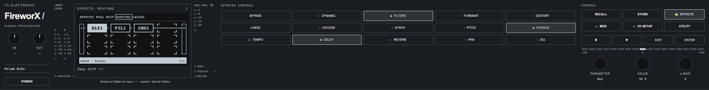
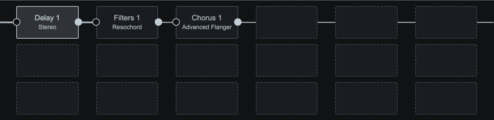
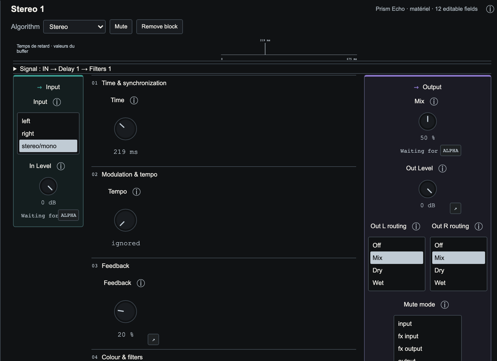
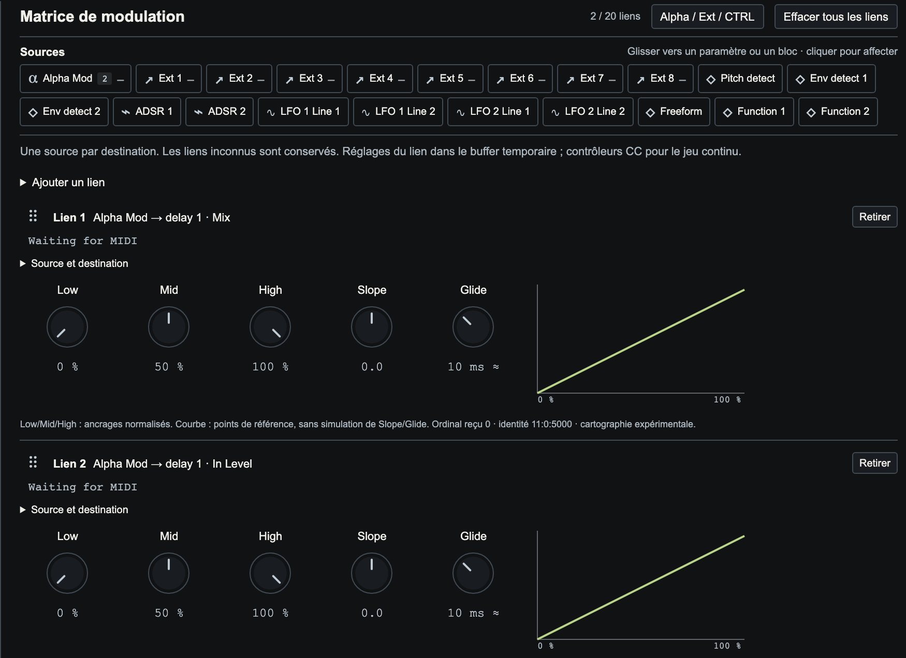
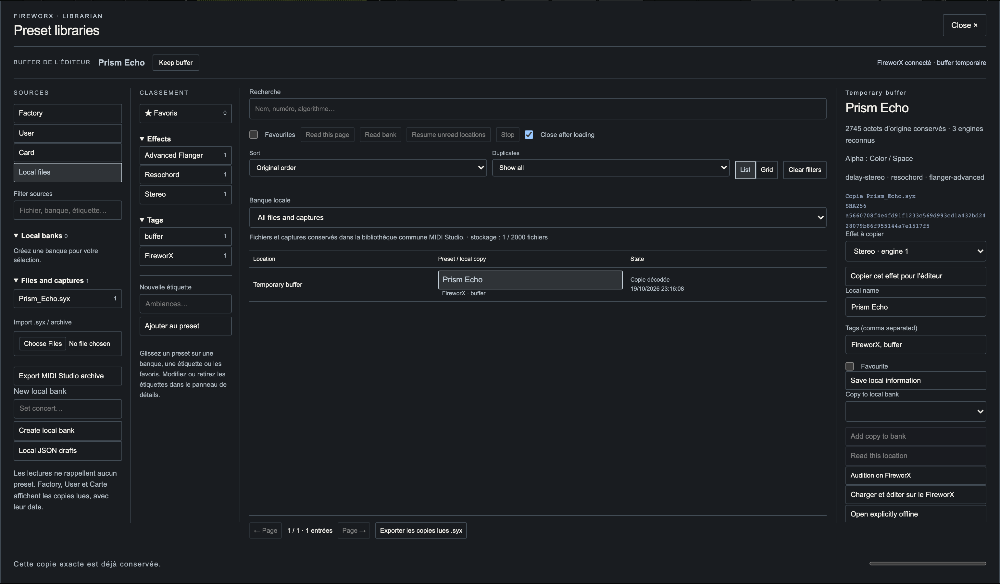
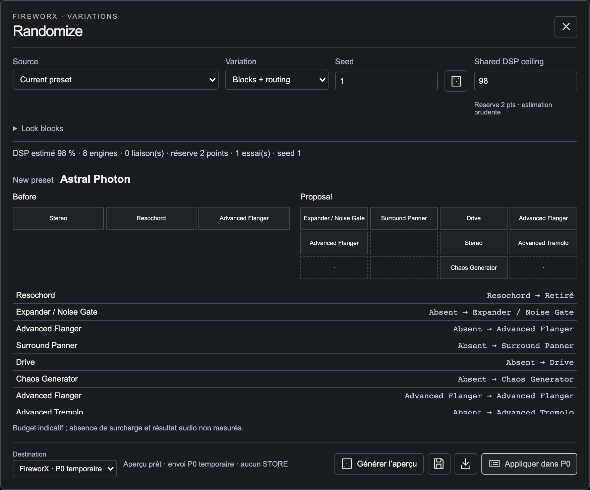
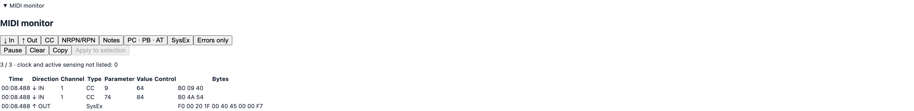

# FireworX — User manual

Local edition, 19 October 2026. MIDI Factory application / MIDI Studio module, alpha version 0.1.0. Protocol target: TC Electronic FireworX OS 2.00 and later, based on MIDI Specification V1.00, 20 July 1999. This documented target is not certification of every firmware release. MIDI interface firmware, such as mioXL firmware, is separate.

## Getting started

This application edits and organizes presets for an external FireworX; it does not process its audio. Keep your studio audio routing in place. Without a connection, you can prepare a chain, import a complete copy, organize the library and generate local variations.

Language follows the MIDI Factory header selection. Automatic uses the browser's language preferences: French when requested, English as fallback. Preset names and hardware values are unchanged. This manual follows the same language selection.

Proposal 02, LIGHT CONSOLE, is the default for new preferences: Porcelain/Cobalt, library and chain on the left, settings on the right, hardware facade and flat rendering. Existing settings are preserved. Appearance selects another proposal; Use host appearance restores the host colours. These choices do not change sound.

The manual follows the active editor palette. The screenshots below show the light palette and a demonstration preset, “Prism Echo”, using simulated MIDI exchanges; they do not certify hardware state. Click a screenshot to open it at full size. The “Illustrated manual (.html)” download includes the images in one file for offline reading; Markdown text remains available separately.

## Connecting

- Connect the computer MIDI output to the FireworX input, and the FireworX output to the computer input. For RTP MIDI and mioXL, check both network/DIN routing directions.
- Use a browser with Web MIDI support and allow MIDI/SysEx access on a secure origin, such as the local application address. Without permission, local editing remains available.
- An active view automatically discovers connected input/output names containing FireworX or Fireworks, case-insensitively. Exactly one candidate in each direction is required; ambiguous matches need manual selection.
- Open MIDI / Buffer with the plug icon to choose the input, output and SysEx Device ID explicitly. The CC MIDI channel and SysEx Device ID are different settings.
- Wait for Live · verified. The connection requires two identical P0 buffer reads. Connecting does not automatically send the old copy restored from browser storage.

Only one view should control the device. Host leases and browser locks limit competing access on the same origin; they cannot coordinate different browser profiles, origins or another MIDI application. Disconnect the previous editor. Disconnect stops automatic reconnection for the current session.



## Facade and preset selection

RECALL shows presets; EFFECTS shows the matrix. Hardware and modern facades share actions. The browser display is not a universal remote control for the physical display's pages.

In RECALL, choose a bank and turn VALUE to browse locations. Double-click the number to type a slot; Enter closes that input while retaining the candidate. When connected, the facade ENTER button recalls the native memory in the selected bank: FireworX receives its Factory/User/Card address, then P0 is read back. The previous buffer is backed up locally. Offline loading remains local. Keyboard Enter also loads it when VALUE, PARAMETER or the Recall screen has focus. Selecting a number is not proof that it has loaded.

Double-click the current name in the LCD or separate name display to rename the edited buffer: up to 20 printable ASCII characters. Enter confirms, Escape cancels; leaving the field does not commit. An unloaded RECALL candidate cannot be renamed this way. Connected rename uses a verified P0 write; it does not save a User memory.

Effect keys reflect the present families and their mute state. P0 changes still use the protected transport. Facade, matrix and settings should share selection; a local counter or LED is not device audio telemetry.





## Signal chain and settings

Add palette blocks by click or drag and drop. Effect tabs show family and instance; the inspector shows the chosen algorithm. Selecting a block opens its settings on one page: input on the left, parameters in the middle, output on the right.

Use a knob for a continuous value; double-click its displayed value to type. Enter confirms and Escape cancels. Small sets of choices use lists. Scrolling the page with the mouse wheel must not change a parameter or write to hardware.

To reposition an existing block, use Routing, choose series before/after or parallel, select the reference block and apply. Matrix sockets and cables also offer connection operations. Instance quotas, valid connections and DSP budget are checked. A visual position alone does not establish a valid audio path.

The compact matrix starts with six columns and expands for occupied cells. The data retain the complete matrix, up to 8 × 8. Muted and parallel blocks still count in DSP estimates.

To copy an effect between presets, choose an effect in the library details and Copy this effect for the editor, or use Copy this effect in the block tools. Select an instance of the same family in the destination preset, then Paste. The algorithm and decoded parameters are copied; Mix, levels and I/O are optional. Destination position, Mute and modulation links are retained; unknown bytes are excluded.





## Modulation, Alpha and external controller

The Modulations tab groups decoded preset sources, links, destinations and editable transformations. Assign links by dragging onto a compatible parameter. Some destinations and undecoded data remain protected.

An external controller input can be selected independently of the FireworX input/output pair. MIDI Learn learns a channel and CC for Alpha or Ext 1–8. Check the displayed assignment and CTRL profile before sending.

Learning a CC in the browser does not reprogram the FireworX global I/O SETUP → CTRL assignments. Match the local profile to the physical configuration; global CTRL read/write is not established here. Alpha, Ext, Bypass and Tap use configured CC assignments and pause during protected SysEx transactions.

Received feedback can animate Alpha and external sources and project their effect on known links. It does not expose the exact internal value of every modulated parameter. The local tempo can request BPM using bounded taps on the confirmed Tempo CC; the application does not generate continuous MIDI Clock or read the actual global BPM back.

Clear all links requires explicit confirmation. For Freeform, open that source, select 1–32 samples and draw the curve. You can also record up to ten seconds of the last known Alpha value, stop and apply the curve. Drawing and recording stay local until applying; neither creates a CTRL assignment.



## Library and banks

In normal library browsing, single-click selects a preset and its details. Double-click loads it: when a connection is available, the application backs up the previous buffer, reads if necessary, sends a copy to P0 and reads it back; offline, it opens a local copy. Open explicitly offline keeps editing local. Close after loading controls whether the library closes.

Displayed numbers are bank-relative: Factory 1–400, User 1–200 and Card 1–800 are accepted address ranges, not a guarantee that every preset exists. A card may be absent or smaller. An unread row is not an acquired preset.

Read this page, Read bank and Resume unread locations acquire copies progressively. Stop keeps the copies already received. Resume requests missing locations; do not repeatedly retry if hardware stops responding.

Local banks organize browser copies: local names, favourites, tags and ordering do not change hardware originals. Imported sources and captures retain their original bytes. Deleting a source removes its local copies/references; export before deletion. Local capacity is bounded and also depends on browser quota.

The grouped User read can preserve the raw dump and extract a recognized header inventory. A packed header is not a fully decoded preset image: read that location in expanded format to edit it. The complete User dump is not transmitted back to the device.



## Files, P0 and hardware saving

The disk icon exports the edited chain or preset as JSON, including blocks, positions and settings and, for a hardware capture, its preserved complete image. Undecoded bytes remain preserved. Opening a file creates a local copy; it grants neither MIDI authority nor hardware memory storage.

Export original .syx preserves the imported/read frame. Export library produces an archive of sources and metadata; this is different from a single preset JSON. The browser chooses the download directory. Check the downloaded file's name and location.

STORE opens a separate library mode. A single click selects a User or Card destination without loading its contents into P0; the current patch name remains visible. Double-click the destination, or press Enter on its selected row, to save automatically: preserve originals, check source and destination, write, then read back. An occupied location is replaced after preserving its original in the local library. STORE followed by a double-click takes three physical clicks. Alternatively, select a destination and click Save.

P0 is the FireworX temporary edit buffer. Applying to P0 changes the current sound without saving User/Card. In STORE mode, double-clicking or pressing Save confirms writing to that exact location; no text needs to be copied. The manual preparation and typed confirmation workflow remains available under Manual confirmation and details. Factory is refused; Card requires confirmation that a writable card is present. Finding the first empty User slot does not itself write anything. Back to library restores ordinary double-click loading.

Do not interrupt an active transaction. A write must complete its readback. A delivered STORE control does not establish complete qualification of retention after restart; that physical validation is still pending.

## Randomize and DSP

Choose the source and variation: Parameters, Structure or Blocks + routing. Lock blocks to retain, select a seed and generate a preview. The same seed and corpus reproduce the draw. The module corpus comes from the current preset and local read/imported copies; a private Factory bank is not bundled.

Parameters draws compatible donor groups; modulated/protected groups may prevent a variation. Structure rearranges permitted blocks. Blocks + routing searches for a composition within the budget, respecting quotas, valid paths and feedback/Insert protections. Not every option produces a proposal for every source.

Choose Local copy to try without MIDI, or FireworX · temporary P0 to apply directly through the verified transport. No save/reopen-file step is required. A variation receives a generated name, which does not reserve a memory slot. The disk icon saves the result; recipe export saves reproducible draw settings.

The common DSP ceiling ranges from 1 to 108% and is shared with block placement; default 98%. Above 100%, allowed tolerance is still flagged. Colours: green below60, orange60–85, red85–95, scarlet95–100, black from100. This is an additive estimate, not a received counter. Observed differences are not applied as automatic calibration. Unknown costs still block an unverifiable addition.



## SysEx exchanges and MIDI monitor

The MIDI monitor is directly accessible at the bottom of the page. It shows received/sent exchanges for this instance, with filters and hexadecimal bytes. Opening it sends nothing. Pause, clear and copy affect the local display. The detailed MIDI / Buffer journal can export JSON and .syx; it is separate from the in-memory monitor.

Documented example of an expanded P0 read request, Device ID0:

```
F0 00 20 1F 00 40 45 00 00 F7
```

The application constructs this request when connecting/reading P0. The address uses two MIDI 7-bit bytes: address = high byte ×128 + low byte. Internal addresses are0 for P0, 1–400 for Factory, 2049–2248 for User and 4097–4896 for Card. Displayed User1 and internal address2049 are different.

Expanded Data20 replies are checked for header, Device ID, size, nibbles and checksum. Proven parameter fields use short Data21 writes. Structural edits use a complete P0 image, a comparison read and mandatory readback. After a complete image, at least8 seconds plus wire serialization are reserved without GET, CC or Clock; the current policy is about8.9 seconds for the usual image.

There is no arbitrary SysEx sending console. Only commands admitted by validators and transaction policy pass. TC documents the containers; detailed parameter mapping includes third-party work and local trials and is not presented as an official manufacturer offset table.



## Local data and preferences

Data live in the browser profile, scoped to the application origin (protocol, hostname and port), rather than an application-chosen filesystem folder. Different local ports, browsers or profiles have separate storage. Clearing site data, changing origin or leaving private browsing may make these data unavailable.

- General LocalStorage: language `bcr32-studio.language.v1`, theme `bcr32-studio.theme.v1`, host presentation preferences.
- Module LocalStorage: prefix `midi-studio.fireworx.<instanceId>.` for appearance, DSP budget, controller profiles and other local preferences. Edit recovery also uses `midi-studio.fireworx.state.<instanceId>.v1`.
- Module IndexedDB: database `midi-studio.fireworx.<instanceId>.:library` for sources, SysEx bytes and organization; database `midi-studio.fireworx.<instanceId>.:journal` for the MIDI journal when storage is available.
- The general MIDI Factory library is separate from the module's own library. Exported .json, .syx and library archives are the portable copies you retain yourself.

UI preferences are not embedded in preset SysEx. Stored data do not restore write permission. A local update does not automatically transfer old prototype libraries. Export from the old origin and import into the new one to migrate.

## Troubleshooting and known limitations

If no ports appear, check MIDI/SysEx permission, browser, cables and RTP session. If ports exist but no reply arrives, check Device ID, both routing directions, SysEx configuration and competing senders. A responsive physical panel or a connected port does not prove a working SysEx return path. Live · verified is the synchronization indicator.

If a write/readback fails, preserve copies and export the journal before diagnosis; do not insist with repeated page refreshes. Transport pauses are intentional. Changing the preset at the physical panel can invalidate the editor reference: read again before reapplying.

Recognized alpha limitations:

- Target OS2.00+; other firmware releases and all card variants are unqualified. No firmware updater is provided.
- No audio processing/measurement, CPU counter or reliable received hardware levels/gain reduction.
- No established global CTRL read/write, no global BPM readback. Learn and local profiles do not replace device configuration.
- SysEx mapping does not guarantee smooth CC automation for every field. Writes may change the physical display page; no known command reopens it.
- Packed User dumps are preserved/inventoried without complete decoding into editable presets or grouped restoration. Read expanded locations separately.
- Protected User/Card STORE is implemented; complete physical qualification and retention after restart remain pending.
- DSP remains estimated, including the allowed100–108 zone; no overload-free guarantee. New dangerous feedback paths, opaque bytes and unsupported destinations remain protected.
- Decoding covers part of the device: unknown bytes are preserved, not all interpreted. Importing alone does not establish audio fidelity.
- Provenance, exhaustive translation of older diagnostics and complete physical acceptance remain release work. This manual does not mean all audit tickets are closed.
