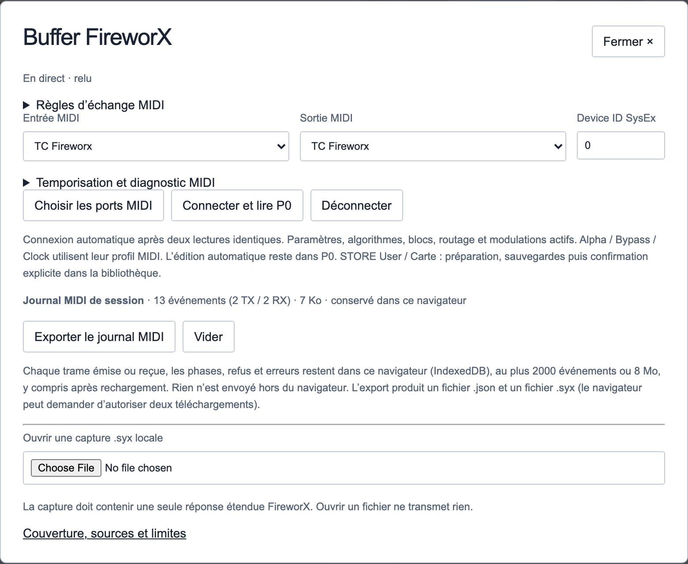
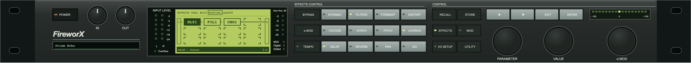
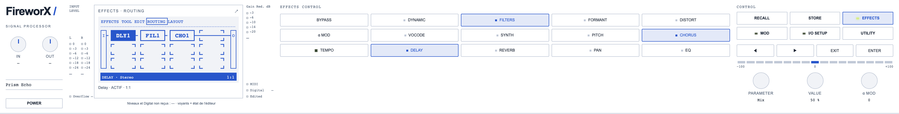
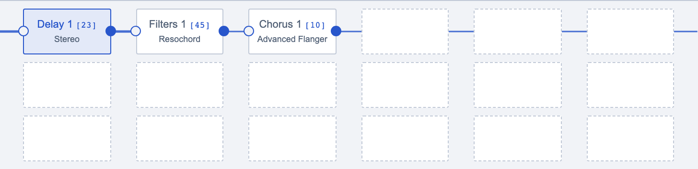
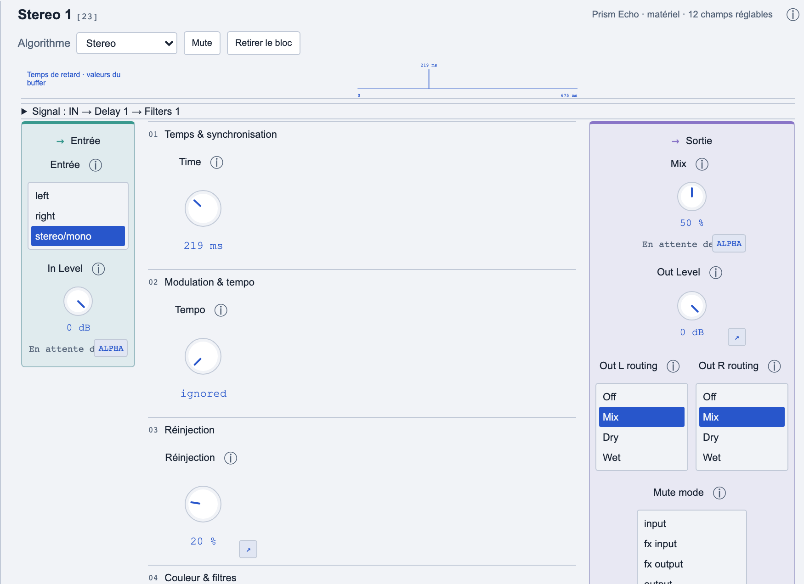
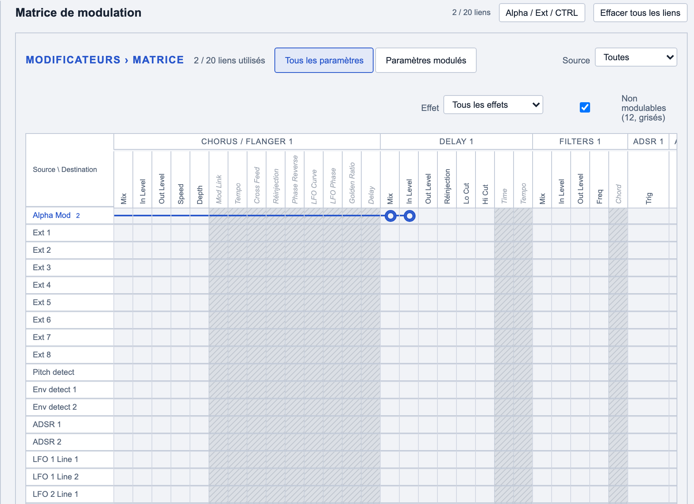
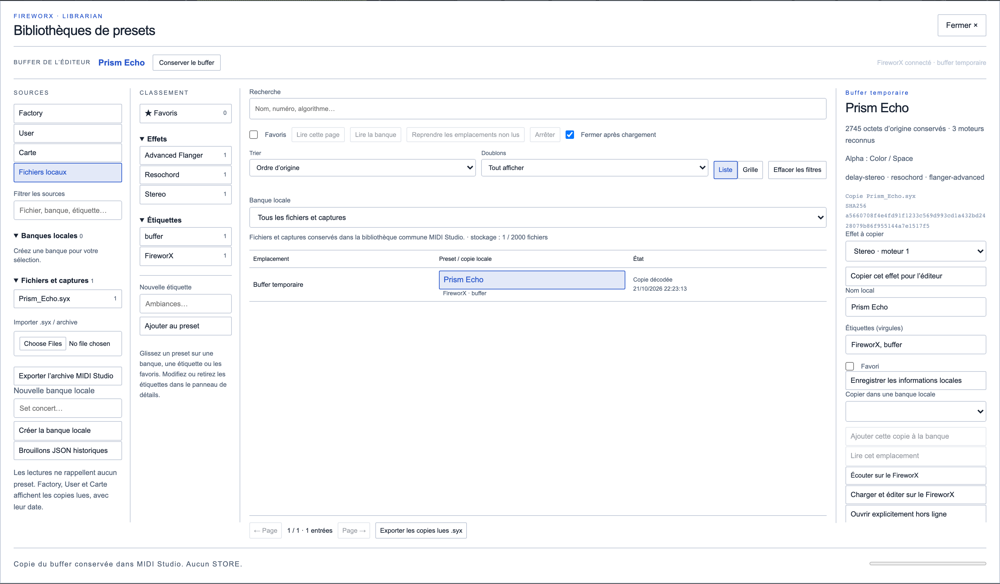
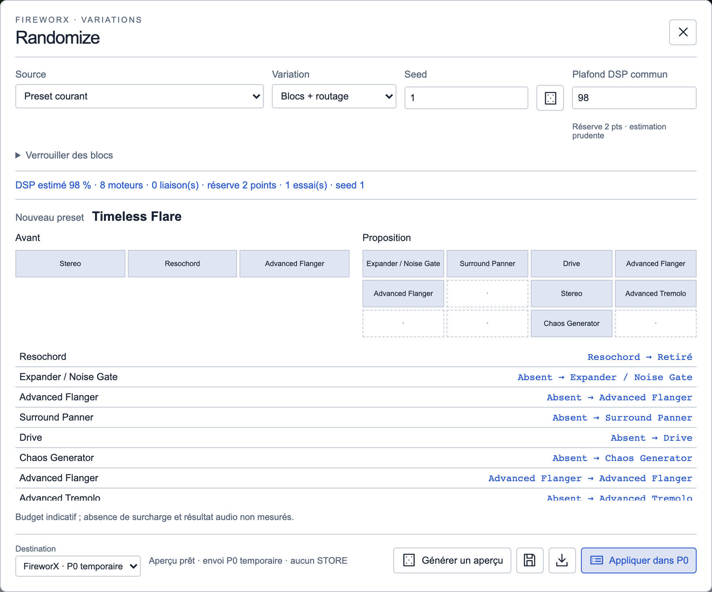
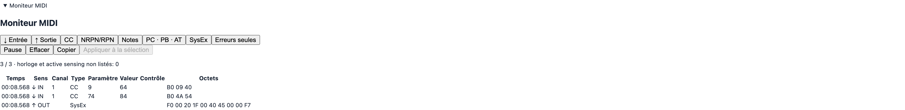

# FireworX — Manuel d’utilisation

Édition locale du 19 octobre 2026. Application MIDI Factory / module MIDI Studio, version alpha 0.1.0. Cible protocolaire : FireworX OS 2.00 et ultérieur, d’après MIDI Specification V1.00 du 20 juillet 1999. Cette cible documentaire ne constitue pas une certification de toutes les versions du firmware. Le firmware de l’interface MIDI, par exemple celui d’une mioXL, est distinct. FireworX Editor est un éditeur indépendant, sans lien avec le fabricant de l’appareil.

## Démarrer

L’application édite et classe les presets d’un FireworX externe ; elle ne produit pas son audio. Le routage audio reste celui du studio. Sans connexion, on peut préparer une chaîne, importer une copie complète, organiser la bibliothèque et générer des variations locales.

La langue est celle choisie dans le bandeau MIDI Factory. En mode automatique, le navigateur détermine la langue : français si demandé par ses préférences, anglais en repli. Les noms des presets et les valeurs du matériel restent inchangés. Le manuel suit cette même sélection.

La proposition 02 « Console claire » est le défaut des nouvelles préférences : Porcelaine/Cobalt, bibliothèque et chaîne à gauche, réglages à droite, façade matérielle, rendu plat. Les réglages existants sont conservés. Apparence permet de choisir une autre proposition ; « Utiliser l’apparence du host » rétablit les couleurs générales. Ces choix ne changent aucun son.

Le manuel reprend la palette active de l’éditeur. Les captures ci-dessous montrent la palette claire et un preset de démonstration « Prism Echo », avec des échanges MIDI simulés ; elles ne certifient pas un état du matériel. Cliquez une capture pour l’ouvrir en grand. Le téléchargement « Manuel illustré (.html) » inclut les images dans un seul fichier, consultable hors ligne ; le texte Markdown reste disponible séparément.

## Se connecter

- Relier la sortie MIDI de l’ordinateur à l’entrée du FireworX, et sa sortie à l’entrée de l’ordinateur. Avec RTP MIDI et mioXL, vérifier les deux sens du routage réseau/DIN.
- Utiliser un navigateur disposant de Web MIDI et autoriser l’accès MIDI/SysEx sur une origine sûre, par exemple l’adresse locale de l’application. Si cette autorisation est absente, l’édition locale reste disponible.
- Une vue active recherche automatiquement les ports connectés contenant « FireworX » ou « Fireworks », sans tenir compte des majuscules. Il faut exactement un candidat dans chaque sens ; une ambiguïté impose un choix manuel.
- Ouvrir MIDI / Buffer avec l’icône de prise pour choisir explicitement l’entrée, la sortie et le Device ID SysEx. Le canal MIDI des CC et le Device ID SysEx sont deux réglages différents.
- Attendre la fin de la connexion et l’état « En direct · relu ». Deux lectures identiques du buffer P0 sont nécessaires. Une connexion ne transmet pas automatiquement l’ancienne copie restaurée depuis le navigateur.

Une seule vue doit piloter cet appareil. Les verrous du host et du navigateur limitent les accès concurrents sur une même origine ; ils ne coordonnent pas deux profils de navigateur, deux origines ou un autre logiciel MIDI. Déconnecter l’éditeur précédent. « Déconnecter » arrête la reconnexion automatique pour la session en cours.



## Façade et sélection des presets

RECALL affiche les presets ; EFFECTS affiche la matrice. Les façades matérielle et moderne partagent les mêmes actions. La représentation du navigateur n’est pas une télécommande universelle des pages de l’écran physique.

En RECALL, sélectionner la banque puis tourner VALUE pour parcourir les emplacements. Double-cliquer le numéro permet de le saisir ; Entrée ferme cette saisie en conservant le candidat. En connexion, le bouton ENTER de la façade rappelle la mémoire native dans la banque choisie : le FireworX reçoit son numéro Factory/User/Carte, puis P0 est relu. Le buffer précédent est conservé localement. Hors ligne, une copie reste locale. La touche Entrée du clavier charge également le candidat lorsque VALUE, PARAMETER ou l’écran Recall a le focus. Un numéro sélectionné n’est pas encore une preuve de chargement.

Double-cliquer le nom courant, dans l’écran ou l’affichage de nom, permet de renommer le buffer édité : 20 caractères ASCII imprimables au maximum. Entrée valide, Échap annule ; quitter le champ ne valide pas. Un candidat RECALL non chargé ne peut pas être renommé ainsi. En connexion, ce renommage passe par une écriture P0 vérifiée ; il ne sauvegarde pas une mémoire User.

Les touches d’effets reflètent les familles présentes et leur état de mute. Le changement d’état dans P0 reste soumis au transport protégé. La façade, la matrice et les réglages doivent montrer la même sélection ; un compteur ou une LED locale n’est pas une télémétrie audio de l’appareil.





## Chaîne du signal et réglages

Les blocs de la palette s’ajoutent par clic ou glisser-déposer. Les onglets d’effets utilisent la famille et le numéro d’instance ; le détail affiche l’algorithme choisi. Sélectionner un bloc affiche ses réglages sur une seule page : entrée à gauche, paramètres au centre, sortie à droite.

Le potard règle une valeur continue ; double-cliquer sa valeur permet la saisie. Entrée confirme, Échap annule. Les petits ensembles de choix utilisent une liste. La simple molette de défilement de la page ne doit pas modifier un paramètre ni écrire dans le matériel.

Pour repositionner un bloc existant, utiliser Raccordement, choisir série avant/après ou parallèle et le bloc de référence, puis appliquer. Les prises et câbles de la matrice proposent aussi les opérations de connexion. Les quotas d’instances, les connexions valides et le budget DSP sont vérifiés. Une position graphique ne signifie pas à elle seule qu’un chemin audio valide existe.

La vue compacte commence à six colonnes et s’étend aux cellules occupées. Les données restent celles de la matrice complète, jusqu’à 8 × 8. Les blocs muets et en parallèle continuent de compter dans l’estimation DSP.

Pour copier un effet entre presets, choisir un effet dans la fiche de la bibliothèque puis « Copier cet effet pour l’éditeur », ou utiliser « Copier cet effet » dans les outils du bloc. Choisir ensuite une instance de la même famille dans le preset de destination et Coller. L’algorithme et les paramètres décodés sont copiés ; Mix, niveaux et E/S sont optionnels. Position, Mute et liens de la destination sont conservés ; les octets inconnus ne sont pas copiés.





## Modulations, Alpha et contrôleur externe

L’onglet Modulations est une matrice : une ligne par source, une colonne par paramètre des blocs du preset. Un clic dans une case vide relie la source de la ligne à ce paramètre ; un clic sur une pastille ouvre le détail du lien (Low, Mid, High, Slope, Glide, suppression). Le menu Source met une source en évidence dans la matrice et dans le tableau des liens. Les paramètres que le FireworX ne module pas restent grisés. Certaines destinations ou données non décodées restent protégées.

Une entrée de contrôleur externe peut être choisie indépendamment de l’entrée/sortie du FireworX. MIDI Learn apprend un canal et un CC pour Alpha ou Ext 1 à 8. Vérifier l’affectation affichée et le profil CTRL avant de transmettre.

Apprendre un CC dans le navigateur ne reprogramme pas les affectations globales I/O SETUP → CTRL du FireworX. Il faut faire correspondre le profil local à la configuration physique ; le protocole de lecture/écriture global CTRL n’est pas établi ici. Alpha, Ext, Bypass et Tap utilisent les CC configurés, avec suspension pendant les transactions SysEx protégées.

Quand une valeur MIDI arrive pour Alpha ou une source externe, sa ligne, la case de chaque lien et la colonne du paramètre modulé scintillent dans la matrice, ainsi que le réglage du bloc concerné. Il ne donne pas la valeur interne exacte de tous les paramètres modulés. Le tempo local peut demander un BPM par taps temporisés sur le CC Tempo confirmé ; l’application ne génère pas d’horloge MIDI continue et ne relit pas le BPM global réel.

« Effacer tous les liens » exige une confirmation explicite. Pour Freeform, ouvrir cette source, choisir 1 à 32 échantillons puis dessiner la courbe. On peut aussi enregistrer jusqu’à dix secondes de la dernière valeur Alpha connue, terminer puis appliquer la courbe. Dessin et enregistrement restent locaux jusqu’à l’application ; ils ne créent aucune affectation CTRL.



## Bibliothèque et banques

En navigation normale de bibliothèque, un simple clic sélectionne un preset et sa fiche. Un double-clic le charge : si la connexion est disponible, l’application sauvegarde le buffer précédent, lit si nécessaire, transmet une copie vers P0 et la relit ; hors ligne, elle ouvre une copie locale. L’action explicite « Ouvrir hors ligne » permet de rester en édition locale. Le réglage « Fermer après chargement » contrôle la fermeture de la bibliothèque.

Les numéros présentés sont relatifs aux banques : Factory 1–400, User 1–200 et Carte 1–800 sont les plages d’adresses admises ; elles ne garantissent pas autant de presets présents. Une carte peut être absente ou plus petite. Une ligne « Non lu » n’est pas un preset déjà acquis.

« Lire cette page », « Lire la banque » et « Reprendre les emplacements non lus » acquièrent les copies progressivement. Arrêter conserve les copies reçues. Une reprise relit les emplacements manquants ; ne pas multiplier les tentatives si le matériel ne répond plus.

Les banques locales sont des classements dans le navigateur : noms locaux, favoris, étiquettes et ordre ne changent pas les originaux matériels. Les sources importées et captures conservent les octets d’origine. Supprimer une source retire ses copies/références locales ; exporter avant suppression. La capacité locale est bornée et dépend aussi du quota du navigateur.

La lecture groupée User peut conserver le dump brut et extraire un inventaire d’en-têtes reconnu. Un en-tête compacté n’est pas une image de preset complètement décodée : lire l’emplacement au format étendu pour l’éditer. Le dump User complet n’est pas réémis vers l’appareil.



## Fichiers, P0 et sauvegarde matérielle

L’icône disquette exporte la chaîne ou le preset édité en JSON, avec ses blocs, positions et réglages et, pour une capture matérielle, son image complète conservée. Les données non décodées restent préservées. Ouvrir un fichier crée une copie locale ; cela n’accorde pas une autorisation MIDI ni une mémoire matérielle.

Exporter l’original .syx conserve la trame importée/lue. Exporter la bibliothèque produit une archive des sources et métadonnées ; ce n’est pas le même fichier qu’un seul preset JSON. Le dossier de téléchargement est choisi par le navigateur. Vérifier le nom et l’emplacement du fichier téléchargé.

La touche STORE ouvre un mode distinct de la bibliothèque. Un simple clic sélectionne la destination User ou Carte sans charger son contenu dans P0 ; le nom du patch courant reste visible. Un double-clic sur la destination, ou Entrée sur la ligne sélectionnée, lance automatiquement la sauvegarde : conservation des originaux, contrôle de la source et de la destination, écriture puis relecture. Un emplacement occupé est remplacé après conservation de son original dans la bibliothèque locale. STORE puis double-clic représente trois clics physiques. On peut aussi sélectionner une destination puis cliquer « Sauvegarder ».

P0 est le buffer temporaire du FireworX. Une application vers P0 change le son courant mais ne sauvegarde pas User/Carte. En mode STORE, le double-clic ou le bouton « Sauvegarder » confirme l’écriture vers cet emplacement précis ; aucun texte n’est à recopier. Le parcours manuel avec préparation et confirmation recopiée reste disponible dans « Détails et confirmation manuelle ». Factory est refusée ; une carte exige la confirmation de sa présence et de son accès en écriture. La suggestion du premier User libre n’écrit rien à elle seule. « Revenir à la bibliothèque » rétablit le double-clic de chargement habituel.

Ne pas interrompre une transaction en cours. L’écriture doit être suivie de sa relecture. La présence d’une commande STORE dans l’interface ne vaut pas qualification complète de la persistance après redémarrage ; cette validation matérielle reste à terminer.

## Randomize et DSP

Choisir la source et la variation : Paramètres, Structure, ou Blocs + routage. Verrouiller les blocs à conserver, choisir une seed puis générer un aperçu. Une seed et un corpus identiques permettent de reproduire le tirage. Le corpus du module vient du preset courant et des copies locales lues/importées ; il n’inclut pas une banque privée Factory embarquée.

Paramètres utilise des groupes donneurs compatibles ; les groupes modulés/protégés peuvent empêcher une variation. Structure réorganise les blocs autorisés. Blocs + routage recherche une composition dans le budget, avec quotas, chemins valides et protections des feedback/Insert. Toutes les options ne produisent pas une proposition pour toute source.

Choisir « Copie locale » pour essayer sans MIDI, ou « FireworX · P0 temporaire » pour appliquer directement via le transport vérifié. Aucun passage par un fichier n’est nécessaire. Une variation reçoit un nom généré ; ce nom ne réserve pas un emplacement mémoire. La disquette conserve le résultat ; l’export de recette conserve les paramètres reproductibles du tirage.

Le plafond DSP commun est réglable de 1 à 108 % et partagé avec l’ajout de blocs ; défaut 98 %. Au-dessus de 100 %, une tolérance autorisée reste signalée. Couleurs : vert sous 60, orange de 60 à 85, rouge de 85 à 95, écarlate de 95 à 100, noir dès 100. Il s’agit d’une estimation additive, pas d’un compteur reçu. Les écarts observés ne sont pas une calibration automatique. Les coûts inconnus restent bloquants pour un ajout non vérifiable.



## Échanges SysEx et moniteur MIDI

Le moniteur MIDI est accessible directement en bas de la page. Il affiche les échanges reçus/émis par cette instance, avec filtres et octets hexadécimaux. Ouvrir le moniteur n’envoie rien. Pause, vider et copier concernent l’affichage local. Le journal détaillé dans MIDI / Buffer peut être exporté en JSON et .syx ; il est distinct du moniteur en mémoire.

Exemple documenté de demande de lecture étendue P0, Device ID 0 :

```
F0 00 20 1F 00 40 45 00 00 F7
```

L’application construit cette demande lorsque l’on connecte/lit P0. L’adresse est encodée sur deux octets MIDI 7 bits : adresse = octet haut × 128 + octet bas. Les adresses internes sont 0 pour P0, 1–400 pour Factory, 2049–2248 pour User et 4097–4896 pour Carte. Ne pas confondre User 1 affiché et l’adresse interne 2049.

La réponse Data20 étendue est contrôlée : en-tête, Device ID, taille, demi-octets et checksum. Les paramètres éprouvés utilisent de courtes écritures Data21. Les changements de structure passent par une image P0 complète, une lecture de comparaison et une relecture obligatoire. Après une image complète, au moins 8 secondes plus la durée de transmission sont réservées sans GET, CC ni Clock ; la politique actuelle est d’environ 8,9 secondes pour l’image habituelle.

Il n’y a pas de console d’envoi SysEx arbitraire. Seules les commandes admises par les validateurs et la politique de transaction passent. Les conteneurs sont documentés par le fabricant ; la cartographie détaillée des paramètres inclut des travaux tiers et essais locaux, et n’est pas présentée comme une table officielle du constructeur.



## Données locales et préférences

Les données sont conservées dans le profil du navigateur, pour l’origine de l’application (protocole, nom d’hôte et port), et non dans un dossier de fichiers choisi par l’application. Deux ports locaux, deux navigateurs ou deux profils ont des stockages différents. Effacer les données du site, changer d’origine ou quitter une session privée peut les rendre indisponibles.

- LocalStorage général : langue `bcr32-studio.language.v1`, thème `bcr32-studio.theme.v1`, préférences de présentation du host.
- LocalStorage du module : préfixe `midi-studio.fireworx.<instanceId>.` pour apparence, budget DSP, profils de contrôleurs et autres préférences locales. La restauration de l’édition utilise aussi `midi-studio.fireworx.state.<instanceId>.v1`.
- IndexedDB du module : base `midi-studio.fireworx.<instanceId>.:library` pour sources, octets SysEx et classement ; base `midi-studio.fireworx.<instanceId>.:journal` pour le journal MIDI, si le stockage est disponible.
- La bibliothèque générale MIDI Factory est distincte de la bibliothèque propre au module. Les fichiers .json, .syx ou archives exportés sont les copies portables à conserver soi-même.

Les préférences d’interface ne sont pas incorporées dans le SysEx d’un preset. L’application ne restaure pas une permission d’écriture à partir du stockage. Une mise à jour locale ne transfère pas automatiquement les bibliothèques de l’ancien prototype. Exporter depuis l’ancienne origine puis importer dans la nouvelle est le parcours de migration.

## Dépannage et limites connues

Si aucun port n’apparaît : vérifier l’autorisation MIDI/SysEx, le navigateur, les câbles et la session RTP. Si les ports existent mais aucune réponse n’arrive : vérifier Device ID, aller/retour, configuration SysEx et l’absence d’autre émetteur. Une façade physique réactive ou un port « connecté » ne prouve pas que le chemin SysEx de retour fonctionne. Le message « En direct · relu » est le repère de synchronisation.

Si une écriture ou relecture échoue, conserver les copies et exporter le journal avant de diagnostiquer ; ne pas insister par rafraîchissements successifs. Les pauses de transport sont intentionnelles. Un changement du preset à la façade peut invalider la référence de l’éditeur : relire avant de réappliquer.

Limites reconnues de cette version alpha :

- Cible OS 2.00+ ; autres firmwares et toutes les variantes de cartes non qualifiés. Aucun mode de mise à jour firmware n’est fourni.
- Aucun traitement audio, mesure audio, compteur CPU, niveaux ou réduction de gain matériel fiables reçus par ce module.
- Pas de lecture/écriture globale CTRL établie, pas de relecture du BPM global ; Learn et profils locaux ne remplacent pas la configuration de la machine.
- Une cartographie SysEx ne garantit pas une automation CC fluide pour chaque champ. Des écritures peuvent modifier la page visible de l’écran physique ; l’application ne peut pas la rouvrir par une commande connue.
- Dumps User compactés conservés/inventoriés, sans décodage complet en presets éditables ni restauration groupée. Lire les emplacements étendus séparément.
- STORE User/Carte implémenté et protégé, qualification matérielle complète et persistance après redémarrage encore à terminer.
- DSP estimatif, y compris dans la zone autorisée 100–108 ; absence de surcharge non garantie. Les nouveaux feedbacks dangereux, données opaques et destinations non prises en charge restent protégés.
- Les données décodées sont une couverture partielle de la machine : les octets inconnus sont préservés, pas tous interprétés. Aucun import ne prouve à lui seul la fidélité audio.
- Les revues de provenance, de traduction exhaustive des anciens diagnostics et la validation matérielle complète restent des étapes avant publication. La présence de ce manuel ne signifie pas que tous les tickets d’audit sont clos.
